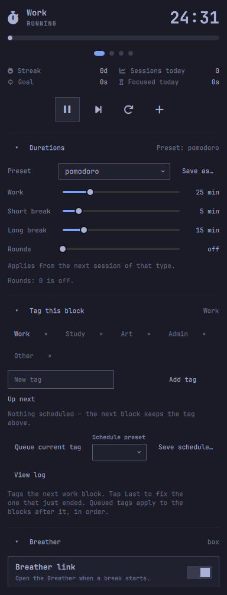
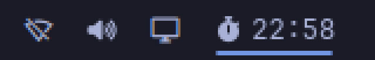
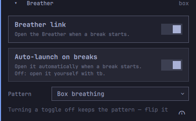

# OmaPomodorchy

An Omarchy bar interface for [Focusd](https://github.com/BibekBhusal0/focusd), the Pomodoro timer. Start and steer focus sessions without leaving the shell, then review the work in Focusd's history, streaks, goals, and statistics. Current version: 1.13.3.

Optional integration with [Terminal Breather](https://github.com/AventurineDream/Terminal-Breather) can start a guided breathing session when a break begins.







## Highlights

- Live work, short-break, and long-break state with remaining time and cycle progress.
- Timer controls for pause, skip, reset, and adding five minutes.
- Focusd streak, daily goal, sessions today, and focus history.
- Editable work-block tags, queued tag schedules, and named duration presets.
- Optional Markdown or CSV export of completed, tagged work blocks.
- Adjustable work and break lengths, round limits, state icons, and linear or circular progress.
- Optional chime for session transitions.
- Breather link: when a break starts, Terminal Breather opens with your chosen pattern (toggle and pattern picker in the panel's Breather section; `breatherEnabled`, `breatherAutoLaunch`, `breakPattern` in `focusd.json`).
- `ompo`, a plain-text terminal shortcut for status and timer control, including over SSH.

## Requirements

- Omarchy Quattro
- [Focusd 0.2.1 or later](https://github.com/BibekBhusal0/focusd). The plugin can install Focusd on first use with SHA-256 verification; alternatively install the AUR package with `yay -S focusd`.
- Python 3 at `/usr/bin/python3` — the plugin's config, session-log, and duration-preset helpers and the `ompo` shortcut use it
- [Terminal Breather](https://github.com/AventurineDream/Terminal-Breather) (optional), for the break-time breathing handoff

## Install

```bash
omarchy plugin add https://github.com/AventurineDream/OmoPomodorachy.git --enable
```

## Use the timer

Click the bar widget to open the panel. Use the controls to pause, skip, reset, or add five minutes. Right-click the widget to skip to the next session; middle-click resets the current timer. The info page links to Focusd settings and statistics.

Start Focusd from a terminal with `ompo start` or `focusd -s`. To open the panel from a Hyprland keybinding:

```lua
o.bind("CTRL", "T", "exec, omarchy-shell shell summon aven.omapomodorchy")
```

### Terminal shortcut

Install the helper from a checkout:

```bash
install -Dm755 cli/ompo ~/.local/bin/ompo
```

Then use it to inspect or control the timer:

```text
ompo                 # Print the current session and today's focus
ompo start           # Start, or resume a paused session
ompo start work      # Start a fresh work session
ompo pause
ompo resume
```

`ompo start` preserves the remaining time when resuming. Naming a session starts it fresh. `ompo pause` and `ompo resume` report a no-op when the timer is not in the matching state.

## Configure

Plugin options are stored in `~/.config/omarchy/focusd.json` and watched for changes. Focusd's timer presets live in `~/.config/focusd/config.toml`; duration edits apply to the next session of that type, not to a session already running.

| Option | Purpose |
|---|---|
| `progressBarStyle` | `linear` or `circular` panel progress. |
| `icons` | Per-state bar symbols, including work, breaks, and paused states. |
| `sounds`, `soundFile` | Enable the session-transition chime and choose its sound. |
| `rounds` | Stop after a configured number of work sessions; `0` disables the limit. |
| `tags` | Categories offered for work blocks. |
| `breatherEnabled`, `breatherAutoLaunch`, `breakPattern` | Configure the optional Terminal Breather link and break pattern. |
| `focusLogPath` | Optional generated Markdown or CSV export of completed work blocks. |

For example, enable a four-work-session run and choose a break pattern:

```json
{
  "rounds": 4,
  "breatherEnabled": true,
  "breatherAutoLaunch": true,
  "breakPattern": "478"
}
```

Choose tags in the panel before or during a work block. The plugin records completed blocks locally; setting `focusLogPath` to an absolute path additionally exports them, for example into an Obsidian vault:

```json
{ "focusLogPath": "/home/aven/Projects/Obsidian/Aventurine/20_Practices/Focus/Focus Log.md" }
```

CSV is selected by a `.csv` extension (for example `/home/aven/focus-log.csv`). The export is off by default; a non-empty existing file is replaced only when it has the plugin's generated-file marker/header. Empty files are treated as interrupted exports and may be replaced, so a failed first write can recover. On block end, the source log is re-read and validated; malformed or over-1-MiB files are preserved and reported instead of being overwritten. Repair the source log before further blocks can be recorded. Do not edit generated export rows by hand, since they are rebuilt from the session history.

## Uninstall

```bash
omarchy plugin remove aven.omapomodorchy
```

Plugin options stay in `~/.config/omarchy/focusd.json` and completed-block records in `~/.config/omarchy/focusd-sessions.json`; delete them by hand if you want them gone. Focusd itself, its `~/.config/focusd/` presets, and any `focusLogPath` export are left untouched. If you installed `ompo`, remove `~/.local/bin/ompo`.

## Screenshots


## Development

Run the terminal-helper and model checks:

```bash
python3 test/ompo.test.py
node test/FocusdModel.test.js
node test/write-config.test.js
```

## Credits and license

OmaPomodorchy is a fork of Bibek Bhusal's Focusd Omarchy integration ([BibekBhusal0/omarchy-focusd](https://github.com/BibekBhusal0/omarchy-focusd)). The bar widget and panel design were adapted from [Omadoro](https://github.com/brianblakely/omadoro); the session-progress dots were inspired by [omarchy-pomodoro](https://github.com/rodrigojacarei/omarchy-pomodoro). Both projects are MIT-licensed. See [LICENSE](LICENSE) for this repository's license and attribution.

## See also

- [Terminal Breather](https://github.com/AventurineDream/Terminal-Breather) — guided-breathing meditation; OmaPomodorchy opens it automatically when a break starts
- [Ohm-My-Usage-archy-Pi](https://github.com/AventurineDream/Ohm-My-Usage-archy-Pi) — live Oh My Pi provider usage in the bar
